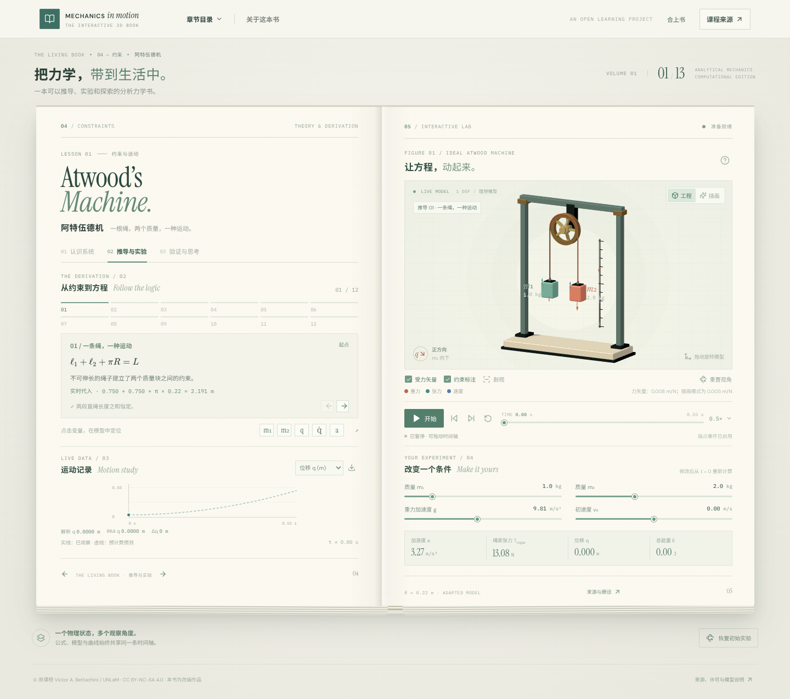

# Mechanics in Motion · 分析力学交互书

一本基于 UNLaM《[Computational Analytical Mechanics](https://github.com/unlam/ComputationalAnalyticalMechanics)》的浏览器交互书原型。**当前完成的是一个经过验证的阿特伍德机垂直切片，而不是全部教材章节。** 目录展示原仓库的 13 个章节目录，其中只有一节可运行；12 步指这一节的推导步骤，不是另外 12 个已完成章节。



## 直接离线使用

下载 [`standalone/atwood-book.html`](standalone/atwood-book.html) 到本地，用支持 WebGL 的现代浏览器直接打开；这是约 10.3 MiB 的**完整单 HTML**，内嵌脚本、样式、字体、Colorfigures 产物与许可，不需要 Node、服务器、CDN 或后端。GitHub 文件页面需要选择下载原始文件，不能只打开 GitHub 的源码预览。已用 Chromium 在阻断外网时验证工程/插画状态、公式步骤、双向选择和来源校验，见 [`reports/standalone-audit.json`](reports/standalone-audit.json)；其他浏览器尚未逐一验证。

**不要直接双击源码 `index.html` 或 `dist/index.html`**：当前 Chromium 会阻止它们的 `file://` 模块/CSS。若选择常规多文件部署，先执行 `npm run build`，再用静态服务提供整个 `dist/`，例如 `python3 -m http.server 8000 --directory dist`；离线根路径和嵌套子路径均已测试，不需要应用后端。

## 开发运行

需要 **Node.js 22.12 或更新版本**（已测 22.22.3）、npm 和支持 WebGL 的浏览器。首次安装需要联网，运行中的书不依赖 CDN。

```bash
npm ci
npm run dev
```

打开终端显示的地址；在 Arena 环境直接使用本会话的 **LIVE PREVIEW**。另可运行 `npm run build && npm run preview` 查看生产构建。Vite 绑定 `0.0.0.0`，允许 `.e2b.app` 预览域；它是开发服务器，不应作为开放公网的生产服务。

## 现在能做什么

- 合上/打开书，三页式理论、推导实验和验证；书页是 **CSS 透视、分层和过渡**，模型是独立的实时 Three.js 画布，不是完整的 WebGL 实体书或物理纸雕引擎。
- 12 个有依赖关系的公式步骤、KaTeX 渲染和实时数值代入；切步自动强调对应质量、绳或运动箭头，手动选择变量可覆盖。模型、公式、曲线与时间轴共用物理状态；切步不改变时间。
- 修改 `m₁`、`m₂`、`g`、初速度；播放、暂停、重置、前进/后退单步、任意定位和变速；修改参数会暂停并从初始状态重算。
- 工程模式使用真实 Machine Skill `GEO`/`MAT` 生成可旋转模型；手绘模式使用真实 Colorfigures 引擎并经同源消息协议接收同一状态。显示力与绳约束、简化滑轮剖视、曲线/CSV 和一题即时反馈。
- 可运行的独立产物：`public/skill-artifacts/atwood-colorfigures.html` 和 `public/skill-artifacts/atwood-machine-standalone.html`。它们可单独打开；**独立 Machine 原型有自己的时钟，不与主书同步**。主书中的 Machine 模型则只使用宿主时钟。

## 理想模型与源教材的区别

以 `q` 为质量块 `m₂` **向下**的位移，假设轻绳不可伸长、无滑移，无质量滑轮、无轴摩擦：

\[
 a=\frac{(m_2-m_1)g}{m_1+m_2},\qquad T_{\rm rope}=\frac{2m_1m_2g}{m_1+m_2}.
\]

默认 `m₁=1 kg, m₂=2 kg, g=9.81 m/s², q₀=v₀=0`，得到 **a = 3.27 m/s²、T = 13.08 N**。绳轮角度与位移相连；在 `|q|=0.5 m` 首次到达端点时暂停，保留碰前速度，**没有模拟碰撞或碰后运动**。这是对第 04 章的理想模型改编，并非完全复刻源 05 仿真：原 05 的无滑移关系含一个 `π` 因子且有转动惯量；区别及原值复现见 [来源映射](docs/SOURCE_MAPPING.md) 和 [物理验证](docs/PHYSICS_VALIDATION.md)。

## 测试与重建

```bash
npm test                  # Vitest：物理、时间轴、真实 3D 几何/箭头
npm run test:e2e          # Chromium：交互、全部推导步和参数截图（Linux x64）
npm run test:derivations  # 三种参数/方向下逐步核对全部 36 个实时代入
npm run build             # 类型检查与常规多文件生产构建
npm run build:standalone  # 生成完整单 HTML
npm run test:standalone   # 先运行上两项，检查 file:// / 离线根目录 / 子目录
npm run test:machine      # 独立 Machine 原型的实际运行与边界
npm audit                 # npm 依赖安全检查；不是下面的教材审计
```

截至本次运行，Vitest **21/21**、主书 Playwright **18/18**、独立 Machine 原型 **7/7**；单文件、两种离线静态部署及独立 Colorfigures 的 `file://` 检查通过。`npm audit` 当时为 0 个已知漏洞（漏洞数据库会变化）。测试覆盖 **12/12 已展示的理想模型推导**，以及 18 个具名边界/参数情形和 100 个固定种子参数组，每组 9 个独立参考采样；它们不是 118 个独立课程；另以整数有理数判别式覆盖 UI 网格内 2,366 个切触和 16,026 个相邻参数组合的双向数值边界。17 个具名情形可由界面滑块复现并逐个截图，另一个近等质量压力测试超出滑块精度、仅程序验证；另外在三种参数/方向下逐一对照 36 个实际显示的实时数值。浏览器审计使用 Linux x64 `@sparticuz/chromium`、软件 WebGL 和 `tar`，可用 `CHROMIUM_PATH` 指定 Chromium；不代表其他浏览器或真实 GPU 性能。结果和逐项截图见 [物理验证](docs/PHYSICS_VALIDATION.md)、[视觉复核](docs/VISUAL_VERIFICATION.md)。

Python 审计、基准和原 Notebook 重建（测试过 Python 3.11.2）：

```bash
python3 -m venv .venv
. .venv/bin/activate
python -m pip install -r requirements-lock.txt
mkdir -p content/source
git clone https://github.com/unlam/ComputationalAnalyticalMechanics.git content/source/ComputationalAnalyticalMechanics
git -C content/source/ComputationalAnalyticalMechanics checkout --detach 387f2df07e70ba3bdff2c66460c04f6ae6ba2055
# 默认读取上述路径；也可设置 COURSE_SOURCE 指向同一 commit 的已有克隆
npm run audit             # 213 个源文件、Notebook/PDF/LaTeX 描述性扫描
npm run build:lessons     # 课程和模型候选索引
npm run extract:equations # 保留原文的有界 SymPy Lark 候选解析
npm run execute:source    # 完整执行两份阿特伍德原始 Notebook，不修改源文件
npm run validate:python   # SymPy 推导 + SciPy 四例和源 05 数值复现
npm run audit:derivations # 12 步逐式证明 + 118×9 个独立数值参考
```

可选重建真实技能产物：

```bash
python .claude/skills/colorfigures/scripts/build.py content/skill-src/atwood-colorfigures.html public/skill-artifacts/atwood-colorfigures.html
cp content/skill-src/atwood-machine-uninlined.html machine-prototype.html
node .claude/skills/machine/scripts/inline.mjs machine-prototype.html
npm run build:machine     # 将 Machine kit 和 Three 打包成可 file:// 打开的独立文件
npm run build:standalone  # 把主书、字体和已构建插画合成完整单 HTML
```

锁文件针对已测环境；不同 OS/CPU 可能需要不同 Python wheels 或本机浏览器。原教材克隆、`node_modules`、`.venv` 和 `dist` 不提交。截图及审计产物作为可核查证据保留。

## 文档与诚实边界

- [独立运行、全部推导、同步和案例的深度审查结论](docs/DEEP_AUDIT.md)
- [架构、数据流、状态协议](docs/ARCHITECTURE.md)
- [教材文件、Notebook 和公式来源映射](docs/SOURCE_MAPPING.md)
- [SymPy/SciPy 和原 Notebook 执行结果](docs/PHYSICS_VALIDATION.md)
- [真实技能来源、调用、产物及未完成项](docs/SKILLS_USAGE.md)
- [视觉截图、复核与性能限制](docs/VISUAL_VERIFICATION.md)
- [版权与许可证](docs/LICENSES.md)

尚未实现其他 12 个章节的交互课程，以及 04 章其余 Notebook 和源 05 的原始带惯量模型（逐文件状态见 [来源映射](docs/SOURCE_MAPPING.md)）、非理想滑轮/摩擦/碰撞、多模型通用 DAE、真正可折叠的物理纸雕书、Machine 规定的四轮完整审片与影片；Colorfigures 镜像版本为固定视角。课程原作和改编内容遵循 **CC BY-NC-SA 4.0**，未经许可不得作不符合非商业条件的发布；各技能自身另为 MIT，不能因此豁免课程许可。
